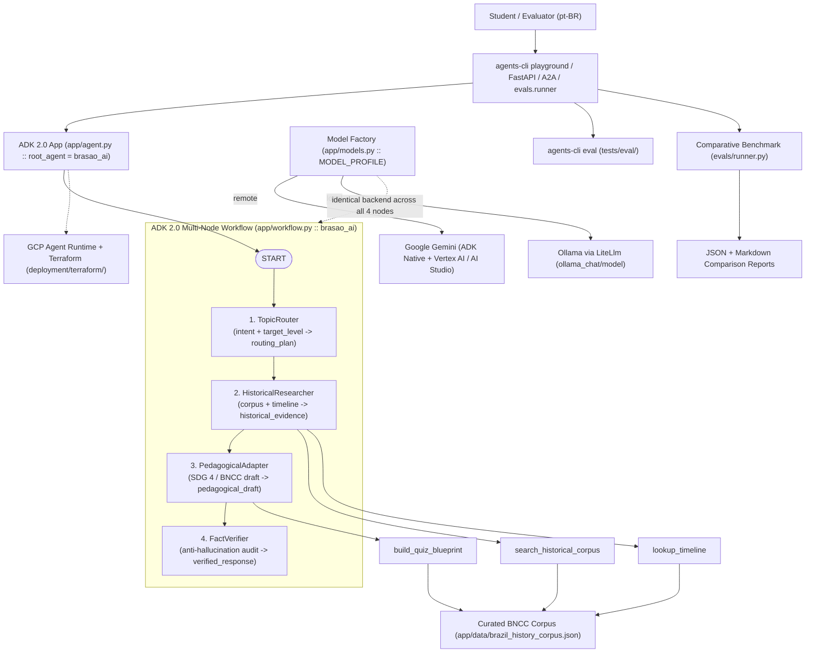

# System Architecture

## Overview

**Brasão AI** (Brazilian History AI Tutor) is scaffolded with Google's official **`google-agents-cli`** (`adk_python`, `agent_runtime`, `github_actions`, Terraform) on **Google Agent Development Kit (ADK) 2.0**. Its root entrypoint (`brasao_ai`) is a **4-node ADK 2.0 `Workflow`** backed by a dual-model factory so **local open-weights models (Ollama + LiteLLM)** and **remote cloud models (Google Gemini)** execute the exact same workflow graph, node instructions, tools, and curated historical knowledge.



## ADK 2.0 Workflow Stages

Every turn runs through a deterministic 4-node `google.adk.Workflow` DAG defined in `app/workflow.py` and exported as `root_agent` (`name="brasao_ai"`) in `app/agent.py`:

| Stage | Node Name | Tools | State Output Key | Responsibility |
| :--- | :--- | :--- | :--- | :--- |
| 1 | `TopicRouter` | None | `routing_plan` | Classifies student intent (`explanation`, `timeline`, `quiz`, `out_of_scope`) and school band (`fundamental_2`, `ensino_medio`, `geral`). |
| 2 | `HistoricalResearcher` | `search_historical_corpus`, `lookup_timeline` | `historical_evidence` | Retrieves grounded facts, chronology, primary actors, critical perspectives, misconceptions, BNCC codes, and sources (or flags `not_found` / `out_of_scope`). |
| 3 | `PedagogicalAdapter` | `build_quiz_blueprint` | `pedagogical_draft` | Drafts the `pt-BR` explanation, timeline synthesis, formative quiz, or out-of-scope redirect aligned with UN SDG 4 and the target school level. |
| 4 | `FactVerifier` | None | `verified_response` | Audits the draft against `historical_evidence` to remove fabricated dates, historical myths, or anachronisms and outputs the final clean `pt-BR` response. |

## Core Design Principles

1. **Official Google Cloud + ADK 2.0 Foundation**
   - Generated by `google-agents-cli` (`agents-cli-manifest.yaml`), providing out-of-the-box FastAPI + A2A serving (`app/fast_api_app.py`), OpenTelemetry/BigQuery observability, GitHub Actions CI/CD (`.github/workflows/`), and Terraform IaC (`deployment/terraform/`).
   - `app/agent.py` exports both `root_agent` (`Workflow(name="brasao_ai")`) and `app = App(root_agent=root_agent, name="app")`, remaining 100% compatible with `agents-cli playground`, `Runner`, `InMemoryRunner`, A2A `AgentCardBuilder`, and `AdkApp`.
2. **Zero-Divergence Model Parity**
   - Both `local` and `remote` profiles instantiate `app.agent.create_history_tutor_agent` (delegating to `app.workflow.create_history_tutor_workflow`) with the exact same `ROOT_AGENT_NAME`, graph topology, node prompts (`app/prompts.py`), tool schemas, state handoff keys, and curated BNCC corpus.
   - Every LLM node calls `app.models.build_model(settings, profile)` so switching `MODEL_PROFILE=local` vs. `MODEL_PROFILE=remote` swaps the entire 4-node graph cleanly.
3. **Dual Evaluation Strategy**
   - **`agents-cli eval` (`tests/eval/`):** Native trace generation, custom LLM-as-a-judge grading (`tests/eval/response_quality.py`), regression diffs (`agents-cli eval compare`), and failure-cluster analysis.
   - **Comparative Benchmark (`evals/`):** Side-by-side execution of both profiles capturing deterministic fact recall, hallucination traps, SDG 4 pedagogy, blind LLM-as-a-judge scoring (`evals/judge.py`), p50/p95 latency, tokens/s, estimated USD cost/1k queries, and offline viability.
4. **Evolution Path**
   - **Phase 1 (Baseline Harness — Completed):** Grounded single ADK 2.0 `Agent` with curated BNCC tools + dual-model benchmark + GCP Terraform IaC.
   - **Phase 2 (ADK 2.0 Workflow — Implemented):** Multi-node `google.adk.Workflow` DAG (`TopicRouter` -> `HistoricalResearcher` -> `PedagogicalAdapter` -> `FactVerifier`) with strict local/remote parity.
   - **Phase 3 (Offline Hybrid RAG):** Swap lexical retrieval in `app/tools/corpus.py` for a local vector index + Ollama embeddings while preserving the tool interface.

## Repository Layout

```text
.
├── AGENTS.md                           # Unified agents-cli + ODS 4 engineering harness
├── agents-cli-manifest.yaml            # Official google-agents-cli project manifest
├── .agents/
│   ├── rules/                          # Always-on ADK 2.0 & SDG 4 domain rules
│   └── skills/                         # Procedural runbooks (benchmarking, corpus curation)
├── .github/workflows/                  # Official CI/CD pipelines (PR checks, staging, prod)
├── app/
│   ├── agent.py                        # ADK 2.0 root_agent (brasao_ai) & App entrypoint
│   ├── workflow.py                     # 4-node ADK 2.0 Workflow graph factory
│   ├── config.py                       # Typed local/remote settings
│   ├── models.py                       # Gemini vs. LiteLLM Ollama factory
│   ├── prompts.py                      # SDG 4 / BNCC node instructions (pt-BR)
│   ├── fast_api_app.py                 # Official FastAPI / A2A server
│   ├── app_utils/                      # Official A2A, telemetry, and runtime adapters
│   ├── data/                           # Curated BNCC Brazilian History corpus (JSON)
│   └── tools/                          # Corpus search, timeline, and quiz blueprint tools
├── deployment/terraform/               # Official Terraform IaC (single-project, cicd, shared)
├── docs/                               # Architecture, SDG 4 pedagogy, evaluation plan
├── evals/                              # Local vs. Remote side-by-side benchmark harness
├── tests/
│   ├── unit/                           # Fast offline unit tests (CI gate)
│   ├── integration/                    # Live agent & server E2E tests
│   ├── eval/                           # Official agents-cli eval config, judge & datasets
│   └── load_test/                      # Locust load testing scaffold
├── Dockerfile                          # Production container image
├── docker-compose.yml                  # Optional local Ollama container
├── Makefile                            # Standard dev, Ollama, and benchmark shortcuts
└── pyproject.toml                      # uv-managed dependencies, ruff, ty, codespell
```
