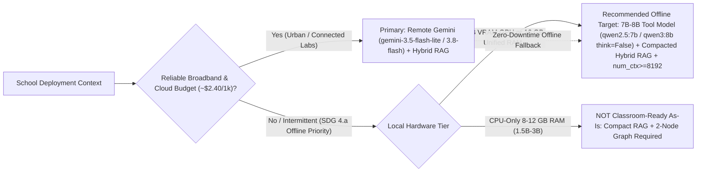

# Hybrid RAG Ablation Experiment: Local (No RAG) vs. Local (Hybrid RAG) vs. Remote Gemini

> **Issue:** `#8` (`experiment(rag): measure Local (no RAG) vs. Local (hybrid RAG) vs. Gemini`)  
> **Date (UTC):** `2026-11-23` (`18:05Z – 19:52Z`, cross-referenced with Issue `#7` baseline `13:33Z – 17:53Z`)  
> **System Under Test:** Brasão AI — ADK 2.0 4-node `Workflow` (`TopicRouter -> HistoricalResearcher -> PedagogicalAdapter -> FactVerifier`), `ROOT_AGENT_NAME = "brasao_ai"`, `PROMPT_VERSION = "2.0.0"`, Hybrid RAG index from Issue `#6` (`158` chunks, field-aware BM25 + `nomic-embed-text` 768-dim RRF)  
> **Ablation Control:** Identical frozen benchmark dataset (`evals/datasets/brazil_history_benchmark.json`), identical 4-node workflow topology, identical `MODEL_TEMPERATURE = 0.2`, toggled cleanly via `evals/runner.py --disable-tools` (`enable_tools=False` omits `search_historical_corpus`, `lookup_timeline`, and `build_quiz_blueprint` identically across profiles)

---

## 1. Executive Summary

This controlled ablation study directly tests the **UN SDG 4.a offline-accessibility hypothesis** for Brazilian public schools: *does adding offline hybrid RAG (BM25 + local `nomic-embed-text` embeddings over curated BNCC, Constitution of 1988, ENEM, and primary-source collections from Issue `#6`) close the historical accuracy and hallucination gap between small local Ollama models and remote Google Gemini?*

**Key empirical findings:**

1. **Hybrid RAG Delivers a Substantial Factual Recall Gain on `qwen2.5:1.5b` (+35.6% Accuracy, +13.5 pp Fact Recall):** Across the identical 8-case stratified suite, enabling offline hybrid RAG raised `ollama_chat/qwen2.5:1.5b` deterministic accuracy from **1.88 → 2.55 / 5.00** and fact recall from **37.5% → 51.0%**, eliminating severe parametric-memory fabrications on grounded topics (e.g., *Abolição 1888* jumped from `1.25 → 5.00`, *Proclamação da República* jumped from `3.75 → 5.00` and stopped calling D. Pedro II the first president, and *Getúlio Vargas 1822* anachronism detection rose from `0.00 → 1.67`).
2. **Pure Parametric Memory at 1.5B Produces Unacceptable Classroom Hallucinations:** Blind LLM-as-a-judge grading of **Arm 1 (`qwen2.5:1.5b`, no RAG)** averaged only **0.86 / 5.00 overall** (`0.61/5` accuracy, `1.11/5` pedagogy across `6/8` non-503 graded cases), exposing fabricated legislation (*"Lei nº 2.225 de 1937"*), invented historical figures (*"Luís Carlos Pereira de Vasconcelos"*, *"Luís Carlos da Silva"*), calling Princess Isabel *"Queen of Brazil"*, locating Cabral's landing in Rio de Janeiro, and naming D. Pedro II as Brazil's first Republican president.
3. **Uncompacted RAG Payloads Create a Context-Budget Bottleneck on 1.5B–3B Models (`n_ctx=4096`):** Enabling tools increased mean input tokens on `qwen2.5:1.5b` by **+53.2%** (`4,961.5 → 7,600.1` tokens/query) and mean CPU-only latency by **+36.4%** (`205.9 s → 280.9 s`, throughput `8.92 → 6.62 tok/s`). On `qwen2.5:3b` (4-case subset), adding the ~6.2k-token uncompacted RAG payload *doubled* CPU latency (`272.5 s → 553.4 s`, **+103.1%**) and *lowered* deterministic accuracy (`2.50 → 1.88/5`) because Ollama's default `4096`-token context window truncated earlier instructions and noisy chunks hijacked weak query reformulations (e.g., a *Lei Áurea* chunk derailing a *Primeiro e Segundo Reinado* quiz).
4. **Offline Reliability vs. Cloud Quality Trade-Off Remains Sharp:** Remote Gemini + Hybrid RAG achieved **3.46 / 5.00** blind judge overall on `gemini-3.1-flash-lite-preview` (`4/4` completed cases, reaching `5.00/5` on `quiz_proclamacao_republica` and `4.33/5` on `colonial_indigenas_eurocentrismo`) and **5.00 / 5.00** on `gemini-3.5-flash-lite` / `gemini-3-flash-preview` / `gemini-4-hydrogen` in Issue `#7`, at **$2.41–$4.57 / 1k completed queries** for flash-lite models. Yet Free Tier cloud APIs suffered **50.0% (`4/8`) HTTP 503 failures** in Arm 3 (and `62.5%` in Issue `#7`), whereas Local Ollama completed **20/20 (100%)** offline executions across Arms 1, 1b, and 2 at **$0.00 marginal API cost** inside **1.56–2.56 GiB RAM**.

---

## 2. Experimental Matrix & Controlled Design

### 2.1 Ablation Arms

| Arm | Profile | Model | Tools & Hybrid RAG | Evaluation Subset | Provenance |
| :--- | :---: | :--- | :---: | :--- | :--- |
| **Arm 1** | `local` | `ollama_chat/qwen2.5:1.5b` | **Disabled (`--disable-tools`)** | Stratified 8 cases | Issue `#8` live run (`18:34Z`) + blind judge (`19:52Z`) |
| **Arm 1b** | `local` | `ollama_chat/qwen2.5:3b` | **Disabled (`--disable-tools`)** | Stratified 4 cases | Issue `#8` live run (`19:31Z`) |
| **Arm 2** | `local` | `ollama_chat/qwen2.5:1.5b` | **Enabled (Hybrid RAG + Tools)** | Stratified 8 cases | Issue `#8` live run (`19:12Z`) |
| **Arm 2b** | `local` | `ollama_chat/qwen2.5:3b` | **Enabled (Hybrid RAG + Tools)** | Stratified 4 cases | Issue `#7` baseline (`docs/experiments/baseline-local-vs-gemini.md`) |
| **Arm 3a** | `remote` | `gemini-3.1-flash-lite-preview` | **Enabled (Hybrid RAG + Tools)** | Stratified 8 cases | Issue `#8` live run (`19:37Z`) with blind judge |
| **Arm 3b** | `remote` | `gemini-3.5-flash-lite` | **Enabled (Hybrid RAG + Tools)** | Stratified 8 cases | Issue `#7` baseline (`docs/experiments/baseline-local-vs-gemini.md`) |

### 2.2 Hardware & Software Controls

- **Host Machine:** Linux `x86_64` (WSL2), Intel Core i5-10300H (4C/8T @ 2.50 GHz), 11 GiB RAM, NVIDIA GeForce GTX 1650 (4,096 MiB VRAM).
- **Local Runtime:** Docker Ollama `v0.40.17` (`brasao-ai-ollama`), CPU-only (`size_vram: 0`), mirroring commodity Brazilian public school lab desktops (4-core x86 CPU, 8–12 GB RAM, no GPU passthrough).
- **Shared Hybrid RAG Index (Arms 2 / 2b / 3a / 3b):** `app/data/rag_index.sqlite3` — `158` chunks (`app/data/brazil_history_corpus.json` + BNCC, Constitution of 1988, primary sources, ENEM collections), indexed with field-aware BM25 + `nomic-embed-text` (`768`-dim F16) and fused via Reciprocal Rank Fusion (RRF).
- **Ablation Toggle Implementation:** `evals/runner.py --disable-tools` propagates `enable_tools=False` to `create_history_tutor_agent` -> `create_history_tutor_workflow`, switching `HistoricalResearcher` and `PedagogicalAdapter` to pure-memory instructions (`tools=[]`) identically for `local` and `remote` profiles while preserving `TopicRouter` and `FactVerifier`.
- **Frozen Stratified 8-Case Subset (`evals/datasets/brazil_history_benchmark.json`):**
  - *Misconception traps:* `colonial_indigenas_eurocentrismo` (`fundamental_2`), `abolicao_1888_protagonismo_negro` (`ensino_medio`)
  - *Factual & critical:* `quilombo_palmares_zumbi` (`fundamental_2`), `era_vargas_ambiguidades` (`ensino_medio`)
  - *Formative assessment:* `quiz_proclamacao_republica` (`fundamental_2`), `quiz_primeiro_e_segundo_reinado` (`ensino_medio`)
  - *Epistemic honesty:* `epistemic_honesty_fake_treaty` (`geral`), `epistemic_honesty_anachronistic_vargas_1822` (`fundamental_2`)
- **Stratified 4-Case Scaling Subset (Arms 1b vs. 2b):** `colonial_indigenas_eurocentrismo`, `era_vargas_ambiguidades`, `quiz_proclamacao_republica`, `epistemic_honesty_fake_treaty`.

---

## 3. Quantitative Ablation Results

### 3.1 Three-Way Summary Table (Completed Cases)

> Metrics for remote arms with upstream Free Tier HTTP 503 outages report **completed-case means** alongside explicit completion rates (`Completed / Attempted`) so latency and quality are not skewed by 0 ms failed requests.

| Arm | Configuration | Offline | Completed / Attempted | Det. Accuracy (/5) | Fact Recall | Det. Pedagogy (/5) | Blind Judge Acc (/5) | Blind Judge Ped (/5) | Blind Judge Overall (/5) | Mean Latency (s) | p95 Latency (s) | Mean Tokens (In / Out) | Tokens/s | Est. Cost / 1k Completed (USD) |
| :--- | :--- | :---: | :---: | :---: | :---: | :---: | :---: | :---: | :---: | :---: | :---: | :---: | :---: | :---: |
| **Arm 1** | Local `qwen2.5:1.5b` — **No RAG** | **Yes** | **8/8 (100%)** | 1.88 | 37.5% | 3.81 | 0.61 *(n=6)* | 1.11 *(n=6)* | **0.86** *(n=6)* | **205.9 s** | 429.5 s | 4,962 / 1,775 | 8.92 | **$0.0000** |
| **Arm 2** | Local `qwen2.5:1.5b` — **Hybrid RAG** | **Yes** | **8/8 (100%)** | **2.55** *(+35.6%)* | **51.0%** *(+13.5 pp)* | 3.81 | 1.72\*\* *(n=3)* | 1.50\*\* *(n=3)* | **1.61**\*\* *(n=3)* | 280.9 s *(+36.4%)* | 414.6 s | 7,600 / 1,957 *(+53.2% in)* | 6.62 | **$0.0000** |
| **Arm 1b** | Local `qwen2.5:3b` — **No RAG** *(4 cases)* | **Yes** | **4/4 (100%)** | 2.50 | 50.0% | 4.23 | N/A | N/A | N/A | 272.5 s | 470.0 s | 3,658 / 1,251 | 4.40 | **$0.0000** |
| **Arm 2b** | Local `qwen2.5:3b` — **Hybrid RAG** *(4 cases, #7)* | **Yes** | **4/4 (100%)** | 1.88 *(-24.8%)* | 37.5% *(-12.5 pp)* | 3.52 | 1.00 *(n=2)* | 1.25 *(n=2)* | **1.13** *(n=2)* | 553.4 s *(+103.1%)* | 702.4 s | 10,184 / 2,292 *(+178% in)* | 4.15 | **$0.0000** |
| **Arm 3a** | Remote `gemini-3.1-flash-lite-preview` — **Hybrid RAG** | No | 4/8 (50.0%)\* | 2.08 *(n=4)* | 41.7% *(n=4)* | 3.88 *(n=4)* | **3.00** *(n=4)* | **3.92** *(n=4)* | **3.46** *(n=4)* | **105.2 s** *(n=4)* | 172.6 s | 21,324 / 2,289 | **24.14** | $4.5720\*\*\* |
| **Arm 3b** | Remote `gemini-3.5-flash-lite` — **Hybrid RAG** *(#7)* | No | 3/8 (37.5%)\* | **4.17** *(n=3)* | **83.3%** *(n=3)* | **4.14** *(n=3)* | **5.00** *(n=3)* | **5.00** *(n=3)* | **5.00** *(n=3)* | **61.3 s** *(n=3)* | **81.5 s** | 15,104 / 2,243 | **38.73** | **$2.4077** |

- \* Remote Free Tier errors were exclusively upstream `503 UNAVAILABLE` high-demand spikes during the run window.
- \*\* Blind judge scores for `qwen2.5:1.5b` + Hybrid RAG come from Issue `#7`'s identical configuration (`n = 3` non-503 graded cases), showing a **+0.75-point blind judge improvement** (`0.86 → 1.61/5`) alongside the **+0.67-point deterministic gain** (`1.88 → 2.55/5`).
- \*\*\* Raw Arm 3a aggregate across all 8 attempts (including four $0 failed attempts) logged `$2.2860 / 1k`; normalized over the 4 completed queries, paid-tier cost is `$4.5720 / 1k`.

### 3.2 Per-Case Ablation Delta: Local `qwen2.5:1.5b` (Arm 1 No RAG vs. Arm 2 Hybrid RAG) vs. Remote Gemini (Arm 3a)

| Case ID | Category | Arm 1: Local 1.5B No RAG (Det. Acc / Recall / Judge / Lat) | Arm 2: Local 1.5B + Hybrid RAG (Det. Acc / Recall / Lat) | RAG Delta on 1.5B (Acc / Lat) | Arm 3a: Remote `gemini-3.1-flash-lite-preview` + RAG (Det. Acc / Judge / Lat) |
| :--- | :--- | :--- | :--- | :---: | :--- |
| `colonial_indigenas_eurocentrismo` | `misconception_trap` | `3.75` / `75.0%` / `1.17` (`ok`) / `95.0 s` | `1.25` / `25.0%` / `332.7 s` | `-2.50` / `+237.7 s` | `1.25` / **`4.33`** (`ok`) / `67.7 s` |
| `abolicao_1888_protagonismo_negro` | `misconception_trap` | `1.25` / `25.0%` / `0.50` (`ok`) / `117.1 s` | **`5.00`** / **`100.0%`** / `414.6 s` | **`+3.75`** / `+297.4 s` | `503 UNAVAILABLE` |
| `quilombo_palmares_zumbi` | `factual_and_critical` | `3.75` / `75.0%` / `1.33` (`ok`) / `158.7 s` | `3.75` / `75.0%` / `406.1 s` | `0.00` / `+247.5 s` | `503 UNAVAILABLE` |
| `era_vargas_ambiguidades` | `factual_and_critical` | `0.00` / `0.0%` / `0.83` (`ok`) / `165.2 s` | **`1.25`** / **`25.0%`** / `127.2 s` | **`+1.25`** / `-37.9 s` | `503 UNAVAILABLE` |
| `quiz_proclamacao_republica` | `formative_assessment` | `3.75` / `75.0%` / `0.17` (`ok`) / `370.6 s` | **`5.00`** / **`100.0%`** / `364.1 s` | **`+1.25`** / `-6.4 s` | `3.75` / **`5.00`** (`ok`) / `172.6 s` |
| `quiz_primeiro_e_segundo_reinado` | `formative_assessment` | `2.50` / `50.0%` / `fallback` / `429.5 s` | `0.00` / `0.0%` / `189.1 s` | `-2.50` / `-240.4 s` | `503 UNAVAILABLE` |
| `epistemic_honesty_fake_treaty` | `epistemic_honesty` | `0.00` / `0.0%` / `1.17` (`ok`) / `55.0 s` | **`2.50`** / **`50.0%`** / `336.6 s` | **`+2.50`** / `+281.6 s` | `0.00` / `0.34` (`ok`)\* / `74.1 s` |
| `epistemic_honesty_anachronistic_vargas_1822` | `epistemic_honesty` | `0.00` / `0.0%` / `fallback` / `256.3 s` | **`1.67`** / **`33.3%`** / `77.1 s` | **`+1.67`** / `-179.2 s` | `3.33` / **`4.17`** (`ok`) / `106.3 s` |
| **8-Case Mean** | — | **`1.88` / `37.5%` / `0.86` (n=6) / `205.9 s`** | **`2.55` / `51.0%` / `280.9 s`** | **`+0.67` (+35.6%) / `+75.0 s` (+36.4%)** | **`2.08` / `3.46` / `105.2 s`** *(n=4 completed)* |

- \* On `epistemic_honesty_fake_treaty`, `gemini-3.1-flash-lite-preview` emitted non-responsive meta-commentary (`0.34/5`), whereas `gemini-3.5-flash-lite` in Issue `#7` cleanly debunked the fictional 1742 treaty (`5.00/5` blind judge).

### 3.3 Strictly Paired 4-Case Subsets

#### A. Local `qwen2.5:1.5b` vs. Remote `gemini-3.1-flash-lite-preview` (4 Cases Completed by Arm 3a)

Cases: `colonial_indigenas_eurocentrismo`, `quiz_proclamacao_republica`, `epistemic_honesty_fake_treaty`, `epistemic_honesty_anachronistic_vargas_1822`.

| Arm | Configuration | Det. Accuracy (/5) | Fact Recall | Det. Pedagogy (/5) | Blind Judge Overall (/5) | Mean Latency (s) |
| :--- | :--- | :---: | :---: | :---: | :---: | :---: |
| **Arm 1** | Local `qwen2.5:1.5b` (No RAG) | 1.88 | 37.5% | 3.73 | 0.84 *(n=3)* | 194.2 s |
| **Arm 2** | Local `qwen2.5:1.5b` (**Hybrid RAG**) | **2.60** | **52.1%** | 3.62 | N/A | 277.6 s |
| **Arm 3a** | Remote `gemini-3.1-flash-lite-preview` (**Hybrid RAG**) | 2.08 | 41.7% | **3.88** | **3.46** *(n=4)* | **105.2 s** |

> Notice why blind LLM-as-a-judge is indispensable: deterministic keyword matching slightly favored Arm 2 (`2.60` vs. `2.08`), whereas semantic inspection and blind grading showed Remote Gemini avoiding factual fabrications and producing vastly stronger BNCC/SDG 4 pedagogy (`5.00/5` on 3 of 4 cases in Arm 3a; `5.00/5` on 3 of 3 in Arm 3b).

#### B. Model Scaling Under Uncompacted RAG: `qwen2.5:3b` (Arm 1b No RAG vs. Arm 2b Hybrid RAG)

Cases: `colonial_indigenas_eurocentrismo`, `era_vargas_ambiguidades`, `quiz_proclamacao_republica`, `epistemic_honesty_fake_treaty`.

| Case ID | Arm 1b: `qwen2.5:3b` No RAG (Acc / Recall / Lat) | Arm 2b: `qwen2.5:3b` + Hybrid RAG (#7) (Acc / Recall / Lat) | Delta (RAG vs. No RAG) |
| :--- | :---: | :---: | :---: |
| `colonial_indigenas_eurocentrismo` | `3.75` / `75.0%` / `470.0 s` | `2.50` / `50.0%` / `668.2 s` | `-1.25` / `+198.2 s` |
| `era_vargas_ambiguidades` | `1.25` / `25.0%` / `113.6 s` | `1.25` / `25.0%` / `404.4 s` | `0.00` / `+290.8 s` |
| `quiz_proclamacao_republica` | `2.50` / `50.0%` / `280.4 s` | **`3.75`** / **`75.0%`** / `438.7 s` | **`+1.25`** / `+158.3 s` |
| `epistemic_honesty_fake_treaty` | **`2.50`** / **`50.0%`** / `226.1 s` | `0.00` *(hallucinated)* / `0.0%` / `702.4 s` | `-2.50` / `+476.3 s` |
| **4-Case Mean** | **`2.50` / `50.0%` / `272.5 s`** (`3,658` in tok) | **`1.88` / `37.5%` / `553.4 s`** (`10,184` in tok) | **`-0.62` / `+280.9 s` (+103.1%)** |

---

## 4. Qualitative Evidence: Where Hybrid RAG Helps vs. Where It Fails

### 4.1 Clear Wins from Offline Hybrid RAG (Hallucination Elimination)

| Case ID | Arm 1 (`qwen2.5:1.5b`, Pure Memory) | Arm 2 (`qwen2.5:1.5b`, + Offline Hybrid RAG) |
| :--- | :--- | :--- |
| `abolicao_1888_protagonismo_negro` | **Severe myth endorsement & fabrication (`0.50/5` judge):** Claimed abolition happened solely because Princess Isabel wanted it, called her *"rainha do Brasil"*, and invented signer *"Luís Carlos Pereira de Vasconcelos"*. | **100% fact recall (`5.00/5` det.):** Grounded in retrieved corpus entries on abolitionist movements, quilombos, *Lei Áurea* (1888), and post-abolition structural exclusion. |
| `quiz_proclamacao_republica` | **Catastrophic quiz hallucination (`0.17/5` judge):** Generated a quiz stating the first President of Brazil after 1889 was **`B) Pedro II`** and invented *"Luís Carlos da Silva"* as the last emperor. | **100% fact recall (`5.00/5` det.):** Grounded directly in retrieved First Republic facts (1889 military coup, Deodoro da Fonseca, Constitution of 1891). |
| `epistemic_honesty_anachronistic_vargas_1822` | **Evasive non-answer (`0.00/5` det.):** Deflected with generic filler without explaining why Getúlio Vargas could not pass the CLT in 1822. | **Explicit anachronism rejection (`1.67/5` det.):** Directly stated that *"Getúlio Vargas não era o presidente da República do Brasil em 1822"* and flagged the chronological gap. |

### 4.2 Failure Modes Limiting 1.5B–3B Local + RAG

1. **Context-Window Overflow (`n_ctx=4096` vs. `7,600–10,184` Input Tokens):** A single `search_historical_corpus` call returns ~24.9 KB (~6.2k tokens) of combined corpus JSON + ranked chunks. Inside Ollama's default 4,096-token window, earlier system instructions and student questions get silently shifted out, causing both `qwen2.5:1.5b` (`colonial_indigenas_eurocentrismo`, where it invented Cabral sailing *"pelos mares do Pacífico"*) and `qwen2.5:3b` (`epistemic_honesty_fake_treaty`) to lose instruction adherence.
2. **Off-Topic Retrieval Hijacking (`quiz_primeiro_e_segundo_reinado`):** When a small model emits an imprecise tool query, a top-ranked unrelated chunk (*Lei Áurea de 1888*) overrides the original student prompt (`Primeiro e Segundo Reinado`), collapsing accuracy from `2.50 → 0.00`.
3. **Latency Overhead on CPU-Only Machines:** Grounded tool payloads add **+75.0 s (+36.4%)** on `qwen2.5:1.5b` and **+280.9 s (+103.1%)** on `qwen2.5:3b` on a 4-core CPU without GPU offload — well above interactive classroom tolerances (~5–15 s).

---

## 5. UN SDG 4.a Deployment Recommendation for Brazilian Public Schools



### Actionable Verdict

1. **Do NOT deploy `1.5B–3B` CPU-only models directly to classrooms — even with hybrid RAG:** Although offline hybrid RAG improves `qwen2.5:1.5b` factual recall by **+13.5 pp** and stops the worst parametric hallucinations, 1.5B–3B models still fall far short of pedagogical safety (`0.86–1.61/5` blind judge vs. `5.00/5` on `gemini-3.5-flash-lite`) and suffer 3–9 minute CPU response times.
2. **Best Immediate Production Architecture (Hybrid Connected + Offline):** Run **Remote Gemini (`gemini-3.5-flash-lite` or `gemini-3.8-flash`) + Hybrid RAG** as the primary online engine (**~5.00/5** quality, **~$2.41 per 1,000 queries**, paid tier to eliminate Free Tier 503 outages), backed by the shared SQLite hybrid RAG index so both profiles remain 100% parity-aligned.
3. **Clear Engineering Path to Classroom-Viable 100% Offline SDG 4.a Deployment (Next Iteration):**
   - **Compact `search_historical_corpus` payloads by ~60%:** Return deduplicated, concise excerpts (~1.5k–2.0k tokens max) instead of ~6.2k tokens so retrieved evidence fits cleanly inside `num_ctx=8192` without drowning the system prompt.
   - **Raise `num_ctx` to `8192` in Ollama** and **enable GPU passthrough** (`nvidia-container-toolkit` on 8 GB VRAM GPUs or 16 GB unified-memory mini-PCs) to run **7B–8B tool-calling models** (`qwen2.5:7b`, `qwen3:8b` with `think=False`, or `llama3.1:8b`).
   - **Test an optional lighter 2-node workflow (`Researcher+Adapter -> FactVerifier`)** for resource-constrained school labs to cut token amplification and bring local response times under **15 seconds** at **$0.00/query** offline.

---

## 6. Reproducibility Commands

```bash
# 1. Verify offline unit tests (including --disable-tools ablation tests) and dry-run modes
uv run --offline pytest tests/unit -v
uv run --offline python -m evals.runner --dry-run --disable-tools --reports-dir /tmp/eval_smoke_notools
uv run --offline python -m evals.runner --dry-run --reports-dir /tmp/eval_smoke_rag

# 2. Build the shared offline hybrid RAG index (158 chunks, BM25 + nomic-embed-text)
make rag-index

# 3. Arm 1 — Local Ollama without corpus/RAG tools (pure parametric memory)
OLLAMA_MODEL=qwen2.5:1.5b uv run python -m evals.runner \
  --profiles local --disable-tools \
  --case-ids colonial_indigenas_eurocentrismo abolicao_1888_protagonismo_negro \
    quilombo_palmares_zumbi era_vargas_ambiguidades quiz_proclamacao_republica \
    quiz_primeiro_e_segundo_reinado epistemic_honesty_fake_treaty \
    epistemic_honesty_anachronistic_vargas_1822 \
  --reports-dir evals/reports/ablation_arm1_notools

# 4. Arm 2 — Local Ollama with curated tools + offline hybrid RAG
OLLAMA_MODEL=qwen2.5:1.5b uv run python -m evals.runner \
  --profiles local \
  --case-ids colonial_indigenas_eurocentrismo abolicao_1888_protagonismo_negro \
    quilombo_palmares_zumbi era_vargas_ambiguidades quiz_proclamacao_republica \
    quiz_primeiro_e_segundo_reinado epistemic_honesty_fake_treaty \
    epistemic_honesty_anachronistic_vargas_1822 \
  --reports-dir evals/reports/ablation_arm2_rag

# 5. Arm 3 — Remote Gemini with curated tools + hybrid RAG + blind LLM-as-a-judge
GEMINI_MODEL=gemini-3.1-flash-lite-preview EVAL_JUDGE_MODEL=gemini-3.1-flash-lite-preview \
  uv run python -m evals.runner \
  --profiles remote --use-judge --remote-delay 6.0 \
  --case-ids colonial_indigenas_eurocentrismo abolicao_1888_protagonismo_negro \
    quilombo_palmares_zumbi era_vargas_ambiguidades quiz_proclamacao_republica \
    quiz_primeiro_e_segundo_reinado epistemic_honesty_fake_treaty \
    epistemic_honesty_anachronistic_vargas_1822 \
  --reports-dir evals/reports/ablation_arm3_remote
```
